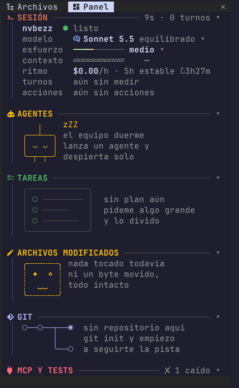
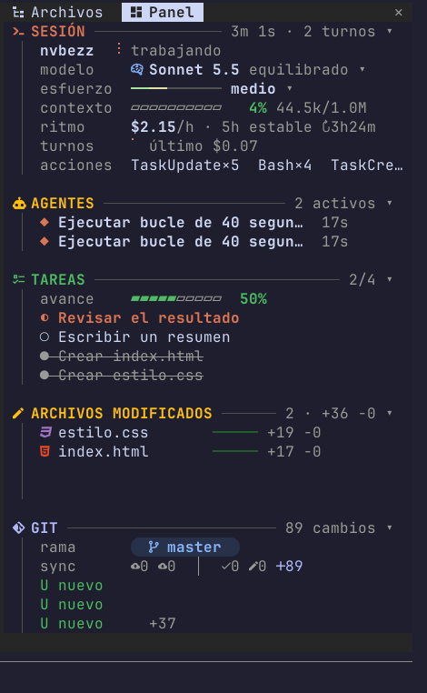
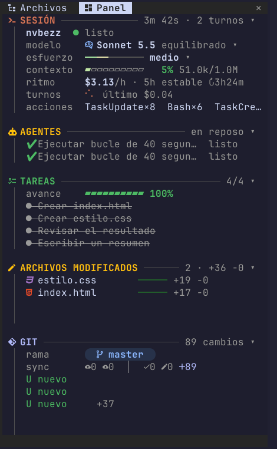
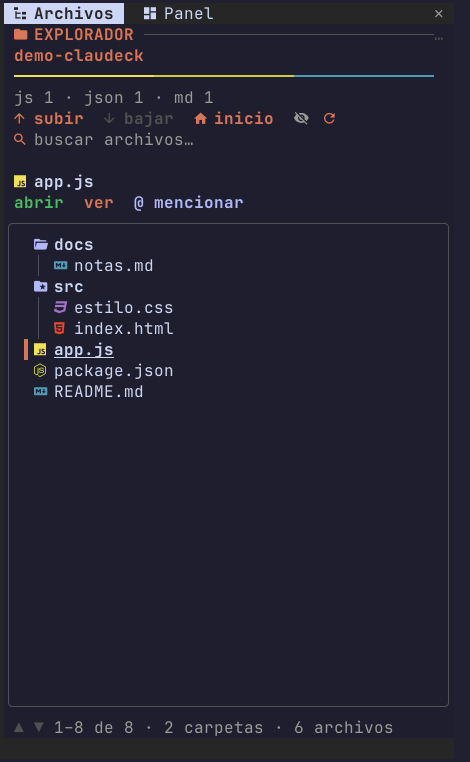
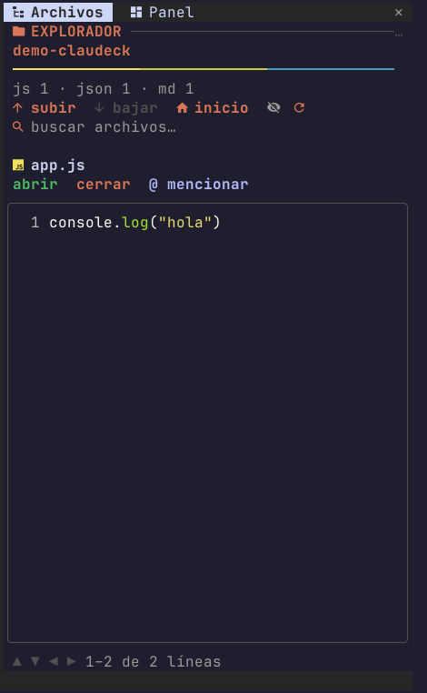

# Claudeck

Panel lateral en vivo para Claude Code: sesión, contexto, gasto, agentes, tareas, git, explorador de archivos, MCP, skills y alertas, todo acoplado al lado de tu terminal.

> English: a live side dashboard mod for Claude Code (session, context, cost, agents, tasks, git, file explorer, MCP, skills and alerts). Spanish UI. Linux and macOS.

## Capturas

<p>
  
  
  
</p>

*En reposo, trabajando con dos agentes y una lista de tareas, y al terminar.*

<p>
  
  
</p>

*El explorador de archivos, con vista previa de código.*

## Qué muestra

| Sección | Contenido |
|---|---|
| **Sesión** | proyecto, estado (trabajando/listo), modelo y esfuerzo (clic para cambiarlos), barra de contexto, ritmo de gasto por hora, proyección del límite de 5 h, coste por turno |
| **Agentes** | subagentes activos y terminados (listo, detenido, falló) con su tiempo; los terminados se ocultan solos tras `agentHideSeconds` |
| **Tareas** | la lista de tareas de Claude con barra de avance; cuando todas están completadas se oculta sola tras `taskHideSeconds` |
| **Archivos modificados** | archivos tocados en la sesión con líneas añadidas y quitadas |
| **Git** | rama, ahead/behind, staged, sin stagear, sin seguimiento, cambios y últimos commits |
| **MCP y tests** | estado de tus servidores MCP y resultado del último test/build/lint |
| **Skills y plugins** | cuántas skills hay por origen y qué plugins están activos |
| **Explorador** | pestaña aparte para navegar carpetas, previsualizar archivos, buscar y mencionar con `@` |

Además avisa con sonido y notificación de escritorio cuando un turno largo termina, cuando el contexto se llena, cuando te acercas al límite de 5 h o cuando un servidor MCP se cae.

## Comandos

| Comando | Qué hace |
|---|---|
| `/panel` | abre el panel |
| `/archivos` | abre el explorador |
| `/buscar <texto>` | busca archivos por nombre (vacío limpia la búsqueda) |
| `/panel-ancho <30-120>` | cambia el ancho en columnas (vacío lo restablece) |
| `/gasto` | gasto de hoy, de la semana y de los últimos 14 días |

## Compatibilidad

| Sistema | Panel | Sonido y notificaciones | Abrir archivos |
|---|---|---|---|
| Linux | sí | `pw-play` o `paplay`, `notify-send` | `xdg-open` |
| macOS | sí | `afplay`, `osascript` | `open` |
| Windows nativo | se ve, pero sin marcas de estado | no | no |
| Windows con WSL | sí, como Linux | según tu WSL | según tu WSL |

La compatibilidad con macOS está construida pero **todavía no probada en un Mac**. Si la pruebas, cuéntalo en un issue.

Para ver los iconos necesitas una fuente Nerd Font (Ghostty ya la incluye). Si no la tienes, pon `isIcons` en `false` y se usan símbolos unicode normales.

## Instalación

Mira [INSTALL.md](INSTALL.md). Si algo no te funciona en tu sistema, [AGENT_GUIDE.md](AGENT_GUIDE.md) le explica a tu agente de Claude Code cómo construir el panel desde cero.

## Configuración

Todas las opciones son opcionales:

| Opción | Por defecto | Para qué sirve |
|---|---|---|
| `width` | 46 | columnas del panel |
| `ctxWarn` / `ctxCrit` | 60 / 85 | el contexto pasa a amarillo y luego a rojo con alerta |
| `limitWarn` | 80 | alerta cuando el límite de 5 h llega a este % |
| `isSound` | true | sonido con cada alerta |
| `isDesktop` | true | notificación de escritorio con cada alerta |
| `notifyMinSeconds` | 30 | solo avisa de turnos que duraron al menos esto |
| `mcpSeconds` | 180 | cada cuánto se consulta el estado de los MCP |
| `taskHideSeconds` | 90 | segundos que se muestra la lista de tareas ya completada antes de ocultarse (0 = nunca) |
| `agentHideSeconds` | 90 | segundos que un agente terminado sigue en la lista antes de ocultarse (0 = nunca) |
| `isIcons` | true | iconos Nerd Font |
| `bgColor` | `#1e1e2e` | fondo del panel, para igualar tu tema |

Para ver cuáles tienes sin definir: `claude plugin configure claudeck`. Para guardar valores se pasa un JSON por stdin:

```bash
echo '{"width":"52","isIcons":"false"}' | claude plugin configure claudeck --values-stdin
```

Las opciones que no menciones conservan su valor.

## Aviso importante: la sección Tareas

La sección **Tareas** solo se llena si Claude Code te da las herramientas de tareas (`TaskCreate`, `TaskUpdate`, `TodoWrite`). Por defecto vienen solo en algunos modelos (Opus 4.7, Sonnet 4.6, Haiku 4.5 y anteriores). **Con modelos más nuevos no aparecen**, y el panel se queda en "sin plan aún" aunque Claude esté trabajando.

Solución: dile a tu agente de Claude Code que habilite las herramientas de tareas para todos los modelos, es decir, que añada esto al bloque `env` de `~/.claude/settings.json` y reinicie:

```json
"CLAUDE_CODE_ENABLE_TODO_TOOLS": "1"
```

A nosotros nos pasó exactamente eso, y con esa variable se resolvió.

## Desarrollo

```bash
claude plugin test .       # tests
claude plugin validate .   # validación del manifiesto
npx -p typescript tsc --noEmit -p .   # tipos
```

## Autor y licencia

Hecho por [Yeider Catari](https://github.com/nvbezz) (`nvbezz`). Licencia [MIT](LICENSE): úsalo, cámbialo y compártelo libremente.
